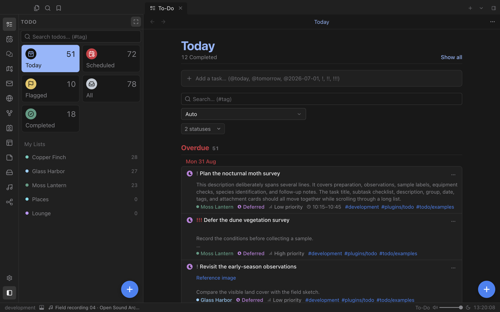
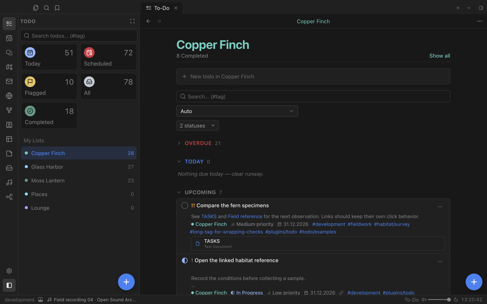
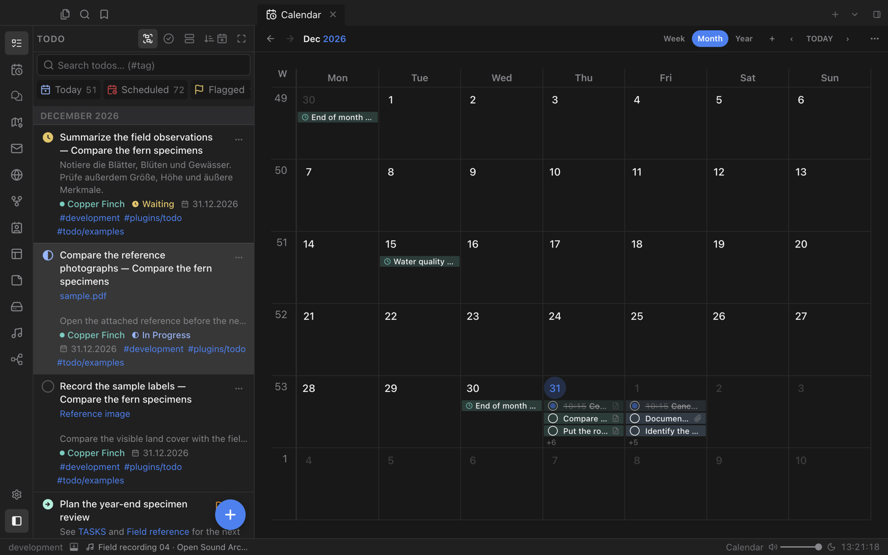

# To-Do

A calm, structured task manager that lives right beside your notes: smart lists, coloured lists, statuses, priorities and dates, with every dated task one click away in Calendar.

## Everything due, at a glance

The left sidebar keeps your smart lists in view: **Today**, **Scheduled**, **Flagged**, **All** and **Completed**, each with a live count. Below them sit your own coloured lists, shared with Calendar so a group means the same thing everywhere.

- Add tasks in one line with shortcuts such as `@today`, `@tomorrow`, `@2026-07-01` and `!`, `!!`, `!!!` for priority.
- A compact composer opens in the sidebar, so you can keep adding tasks without leaving what you are doing.
- Filter by status and search by text or `#tag`.

## Lists that carry real work

Each task can hold a description, statuses such as *Waiting*, *In Progress* or *Deferred*, a priority, tags, a date and time, a location and linked notes or attachments. Lists group tasks into **Overdue**, **Today** and **Upcoming**, and every change is recorded in the task's activity history.

## Planned in Calendar

Dated tasks appear in Calendar automatically. A single click on a dated task reveals it there; a double click opens the editor. Completing a task updates both views in place.

## Works with

- **Calendar** shows your tasks next to events and note dates.
- **Workflow** can create and update tasks as part of an automation.
